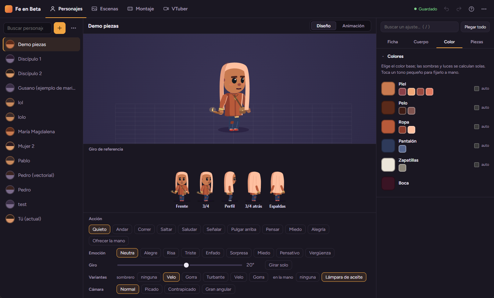
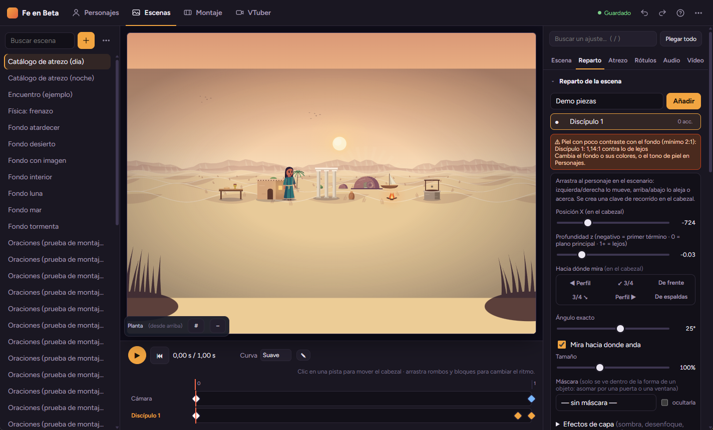
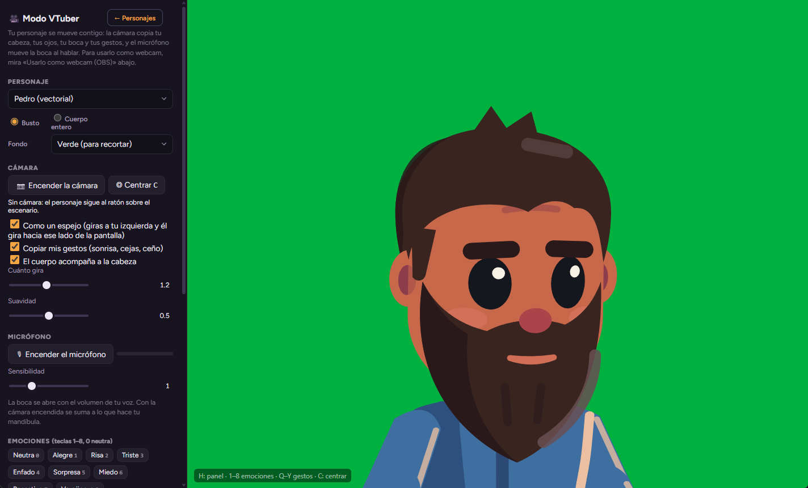

# Fe en Beta Editor

Herramienta para **diseñar personajes 2D, animarlos y montar escenas y shorts** que se renderizan a vídeo, sin escribir código. Toma ideas de Moho (huesos, correcciones por ángulo, deformadores, editor de gráficas) y de Cartoon Animator (interpretar en vivo, bibliotecas de movimientos). Funciona en el navegador o como **app de escritorio para Windows**.



## Índice
- [Qué se puede hacer](#qué-se-puede-hacer)
- [Instalar la app (Windows)](#instalar-la-app-windows)
- [Arrancarlo desde el código](#arrancarlo-desde-el-código)
- [Cómo se guarda todo](#cómo-se-guarda-todo)
- [Atajos de teclado](#atajos-de-teclado)
- [Carpetas](#carpetas)
- [Generar el instalador](#generar-el-instalador)
- [Documentación](#documentación)

## Qué se puede hacer

### Personajes
- **Diseño.**
  - Cuerpo, proporciones (normal o chibi), pelo, barba, ropa y colores. Las sombras y las luces se calculan solas.
  - Piezas propias dibujadas en el taller vectorial o importadas en SVG.
  - Variantes, como un velo o un objeto en la mano.
- **Marioneta vectorial.** Cada parte del cuerpo y de la cabeza se puede redibujar. Admite correcciones por ángulo, como los Smart Bones de Moho, y expresiones dibujadas a mano.
- **Marioneta libre.** Huesos sobre cualquier dibujo o PNG, para animales, objetos o criaturas. Tiene IK, pies clavados al suelo y capas que se doblan con los huesos.
- **Animación.**
  - Acciones con claves y curvas; editor de gráficas con tangentes.
  - Elástico (aplastar y estirar), y seguimiento: cabeza y brazos llegan un poco después.
  - Papel cebolla y asas sobre el lienzo para posar manos, pies, cadera, cabeza y pecho.
- **Interpretar en vivo.** Se graba con el ratón la cabeza, la mirada, un brazo o el cuerpo, con emociones en las teclas 1–8. Se convierte en claves y las tomas se suman por capas.

### Escenas


- **Fondos.** De serie, imagen propia o **láminas** dibujadas por capas con parallax.
- **Reparto.** Personajes con recorridos, formas de andar, acciones y hacia dónde miran.
- **Atrezo.** Objetos animados, animación a mano cuadro a cuadro y física por pieza.
- **Efectos.** Deformador (doblar, ondear, respirar), efectos de capa (sombra, desenfoque, resplandor, opacidad) y máscaras.
- **Cámara, ambiente, rótulos y audio**, todo con claves en la línea de tiempo.
- **Render a MP4** con HyperFrames: vista previa rápida, fragmento o calidad final.

### Montaje
Monta un short a partir de una voz:
1. Transcribir la voz.
2. Crear una escena por frase, con el narrador moviendo la boca.
3. Retocar subtítulos, música y efectos de sonido.
4. Renderizar el short completo.

### VTuber


- **Tu cara mueve al personaje.** Con la webcam copia el giro de la cabeza, la mirada, el parpadeo, la boca y los gestos (sonrisa, cejas, ceño).
- **Tu voz mueve la boca**, con el micrófono.
- **Teclas:** emociones con 1–8 y gestos con Q–Y (saludar, explicar, manos arriba…).
- **Como webcam:** en OBS se añade una fuente de navegador con `vtuber.html?salida`, que tiene el fondo transparente. Con la cámara virtual de OBS, sale en Zoom, Meet, Discord o en directo.

## Instalar la app (Windows)
1. Descarga el instalador de la última versión en [Releases](https://github.com/alastres/editor-personajes-fe-en-beta/releases): `Fe-en-Beta-Editor-<versión>.exe`, unos 240 MB.
2. No está firmado, así que Windows avisará con «Windows protegió su PC». Pulsa **Más información → Ejecutar de todas formas**.
3. Abre **Fe en Beta Editor** desde el acceso directo.

Lo que hay que saber de la app:
- Los datos van en **Documentos/Fe en Beta Editor**. La primera vez se copian ahí los personajes, escenas y láminas de ejemplo.
- **El render a MP4 no necesita nada instalado:** HyperFrames, su navegador y ffmpeg van dentro.
- **Funciones que dependen de otros programas o de internet:**
  - transcribir la voz y montar la música de los shorts necesitan VoiceStudio; sin él, los tiempos se estiman desde el guion;
  - el detector de caras del modo VTuber se descarga de internet la primera vez.

## Arrancarlo desde el código
```bash
node editor-personajes/servidor.js
```
Abre http://localhost:3170. Las demás secciones están en la barra de arriba (`escenas.html`, `montaje.html`, `vtuber.html`).

Requisitos:
- **Node 22 o superior.** El servidor no tiene dependencias.
- **Para renderizar:** HyperFrames con `npx hyperframes@0.9.8` (se descarga solo la primera vez) y ffmpeg. En el equipo del autor, ffmpeg está en `../historia-en-cuatro-actos-tools`.
- **Para transcribir:** VoiceStudio abierto en `127.0.0.1:3900` (opcional).

## Cómo se guarda todo
- **Cada personaje, escena y short es un JSON** legible en su carpeta (`personajes/`, `escenas/`, `shorts/`). Se puede editar a mano o pedírselo a Claude, y el editor recoge los cambios al momento.
- **Se guarda solo** mientras editas. El punto verde de la barra indica que está guardado.
- **Historial y papelera** (menú **⋯** de la barra):
  - antes de sobrescribir, se guarda la versión anterior en `.historial/`, y se puede volver a cualquiera;
  - lo borrado va a la papelera de su carpeta y se puede recuperar.
- **Deshacer y rehacer** con Ctrl+Z / Ctrl+Y.

## Atajos de teclado
| Tecla | Qué hace |
|---|---|
| Ctrl+Z / Ctrl+Y | Deshacer / rehacer |
| Espacio | Reproducir |
| K | Clave en el cabezal (Animación) |
| R | Interpretar en vivo (Animación) |
| 1–8 · 0 | Emoción mientras interpretas en vivo o en VTuber · neutra |
| / | Buscar un ajuste en el panel |
| F1 | Ayuda y visita guiada |
| Taller: V B L P E R C I T | Seleccionar, pincel, lazo, pluma, elipse, rectángulo, cápsula, cuentagotas, texto |

## Carpetas
| Carpeta | Qué hay |
|---|---|
| `editor-personajes/` | La interfaz (Personajes, Escenas, Montaje, VTuber) y el servidor local `servidor.js`. Aspecto común en `tema.css` e `interfaz.js` |
| `comun/` | El motor. `titere25d.js`: el muñeco 2,5D. `personajes.js`: poses, acciones y curvas. `libre.js` y `rig2d.js`: marioneta libre. `escena.js`, `atrezo.js` y `andares.js`: escenas. `montaje.js`: shorts. `vendor/`: GSAP y fuentes |
| `personajes/` | Un JSON por personaje |
| `acciones/` | Biblioteca común de acciones (saludar, explicar, sentarse…) |
| `andares/` | Formas de andar propias |
| `piezas/` | Piezas dibujadas compartidas entre personajes |
| `escenas/` | Un JSON por escena |
| `shorts/` | Un JSON por short del Montaje |
| `ilustraciones/` | Láminas: fondos dibujados por capas |
| `app-escritorio/` | La app de escritorio (Electron) y su instalador |
| `docs/` | Capturas de este README |

Los renders (`escena-<id>/`, `short-<id>/`) y el resto de proyectos de `shorts-flow` no se suben al repositorio (lista blanca en `.gitignore`).

## Generar el instalador
```bash
cd app-escritorio
npm install
npm run dist
```
El instalador sale en `app-escritorio/dist/`. Antes de cada versión nueva, sube `version` en `app-escritorio/package.json`. Todos los detalles están en [app-escritorio/LEEME.md](app-escritorio/LEEME.md).

## Documentación
- [editor-personajes/LEEME.md](editor-personajes/LEEME.md): el manual completo, función por función y con el formato de los datos.
- [app-escritorio/LEEME.md](app-escritorio/LEEME.md): la app de escritorio, el render empaquetado y cómo generar el instalador.
- [ROADMAP.md](ROADMAP.md): lo hecho y lo que falta, por prioridad.

## Sincronizar con GitHub
```powershell
./sincronizar.ps1 "qué cambió"
```
Trae lo último, guarda los cambios en un commit y los sube. También se puede hacer desde el editor: menú **⋯ → Subir a GitHub**; en la app de escritorio esta opción no está.
